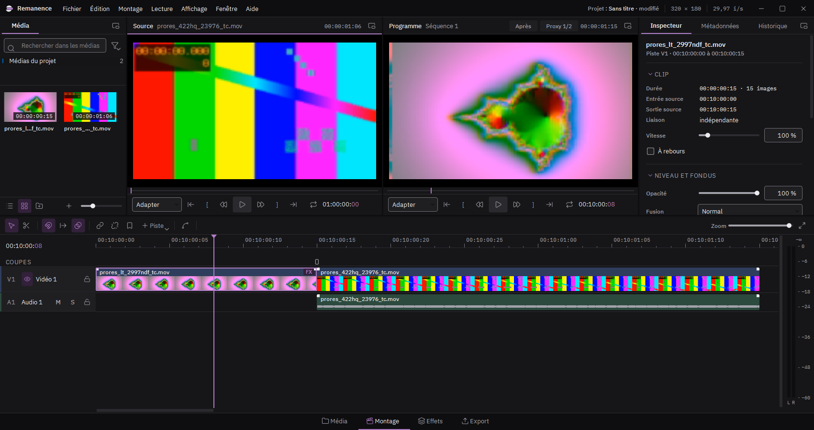

# Remanence

Logiciel libre de montage vidéo pour Windows, tourné vers le datamosh et le glitch art.
Édité par l'association [Flux Croisés](https://www.flux-croises.fr), il fait partie de la suite
**Creative Orbit**.

## Ce que fait Remanence

- **Montage** : timeline à pistes vidéo et audio, gestes de Vegas Pro, moniteurs source et
  programme, espace Cut pour monter vite (bande source, insertion au raccord le plus proche,
  double timeline), position, taille et rotation des clips, titres, séquences imbriquées.
- **Datamosh** : suppression d'images clés, transition datamosh entre deux plans, bloom,
  databending, vecteurs de mouvement réécrits par FFglitch, scripts FFglitch.
- **Glitch en temps réel** sur la carte graphique : décalage RVB, tri de pixels, JPEG extrême,
  écran CRT, perte de synchro, et une trentaine d'autres effets, avec images clés, courbes,
  masques suivis automatiquement et modulateurs (oscillateur, tempo, son, MIDI).
- **Son** : bégaiement, bitcrusher, arrêt de bande, gel, databending audio ; le son peut baver
  avec l'image.
- **Export** : ProRes, DNxHR, H.264, HEVC, AV1, WebM avec transparence, GIF, séquences DPX,
  EXR et TIFF. Les images sans effet gardent exactement les pixels de la source, et un rapport
  vérifie durée, cadence, résolution, timecode et couleurs.

Le détail est dans les [notes de version](NOTES_DE_VERSION.md) et dans le guide illustré
(Aide > Guide dans le logiciel).

## Installer

Téléchargez `Remanence-<version>-installation.exe` dans les
[versions publiées](https://github.com/fluxcroises/remanence/releases), ou installez Remanence
depuis le lanceur Creative Orbit. L'installateur propose une installation pour tous les
utilisateurs (`C:\Program Files\Flux Croisés\Remanence`) ou pour vous seul.

Le programme n'est pas signé : Windows peut afficher « Windows a protégé votre ordinateur ».
Cliquez sur **Informations complémentaires**, puis **Exécuter quand même**.

Il faut Windows 10 ou 11 en 64 bits, et une carte graphique compatible OpenGL 4.3 pour les
effets en temps réel. FFglitch est téléchargé au premier lancement.

## Depuis le code source

1. `Installer.bat` : installe Python 3.12 et les bibliothèques dans le dossier du projet.
2. `Remanence.bat` : lance le logiciel.
3. `Construire.bat` : fabrique `dist\Remanence\Remanence.exe`, puis l'installateur si
   [Inno Setup 6](https://jrsoftware.org/isinfo.php) est installé.

Tests : `.venv\Scripts\python.exe -m pytest -q`.

## Licence

Remanence est un logiciel libre sous licence [GPL 3](LICENSE). Les bibliothèques utilisées et
leurs licences sont dans [LICENCES.md](LICENCES.md).
