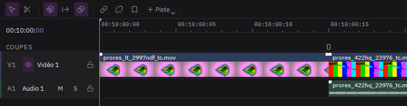

# Monter des clips

1. **Importer** : Fichier > Importer des médias (Ctrl+I), ou glissez des fichiers dans le panneau Média.
2. **Poser** : glissez un média du panneau Média sur la timeline. Le premier média posé règle la taille et la cadence de la séquence, sauf si vous les avez choisies dans Nouveau projet.
3. **Choisir un passage** : double-cliquez un média pour l'ouvrir dans le moniteur Source, placez un point d'entrée (E) et de sortie (S), puis F9 pour l'insérer à la tête de lecture ou F10 pour écraser.
4. **Couper** : S ou B coupe à la tête de lecture. L'outil de coupe (C) coupe là où vous cliquez ; Échap revient à la sélection.
5. **Rogner et déplacer** : tirez le bord d'un clip pour le raccourcir, glissez-le pour le déplacer. Maj déplace l'image sans son son.

6. **Enchaîner** : posez un clip sur la fin du précédent : ils se fondent l'un dans l'autre. Clic droit sur le clip qui entre, Transition du fondu, pour un volet, des blocs, un décalage RVB ou une coupure de signal à la place du mélange (aussi dans l'inspecteur, sous Fondu d'entrée).
7. **Copier** : Ctrl+C, puis Ctrl+V colle à la tête de lecture. Ctrl+D duplique juste après.

8. **Scripts** (Montage > Scripts, ou clic droit sur un clip) : Scramble découpe les clips choisis en morceaux et mélange leur ordre ; Layer les recopie sur de nouvelles pistes, décalés et de plus en plus transparents, pour un écho. Une même graine redonne le même résultat ; Autre tirage en propose un nouveau.

9. **Vitesse** : dans l'inspecteur, Vitesse (50 % : ralenti, 200 % : accéléré) et À rebours. Le clip garde le même passage de sa source ; ce qui le suit sur la piste se décale.
10. **Titre** : Montage > Ajouter un titre (T), à la tête de lecture. Texte, police IBM Plex, taille, position et couleur dans l'inspecteur ; les effets s'y posent comme sur un clip.
11. **Imbriquer** : Montage > Imbriquer la sélection range les clips choisis dans une nouvelle séquence, qui devient un seul clip. Clic droit, Ouvrir la séquence, pour la retoucher ; la liste des séquences, dans la barre de la timeline, ramène à la principale.
12. **Rendu sur place** (Ctrl+Maj+R) : le clip choisi est calculé avec ses effets dans un fichier ProRes 4444, qui le remplace. Utile pour alléger la lecture ou figer un datamosh.

Ctrl+Z annule, sans limite.
