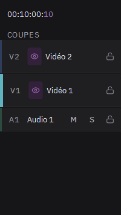

# Organiser les pistes

- **Nouvelle piste en glissant** : lâchez un média, ou glissez un clip, dans la bande juste au-dessus de la piste vidéo du haut. Une piste vidéo se crée et le clip y va.
- **Clic droit sur l'en-tête d'une piste** : ajouter une piste au-dessus ou en dessous, choisir sa couleur, la renommer, la supprimer.
- **Clic droit dans le vide de la timeline** : ajouter une piste vidéo ou audio.
- **Changer l'ordre** : glissez l'en-tête d'une piste sur une autre piste du même type.
- **Renommer** : double-cliquez sur le nom de la piste.

La piste vidéo du haut passe devant les autres. L'œil masque une piste vidéo, le cadenas la verrouille ; M et S coupent le son ou isolent une piste audio.
