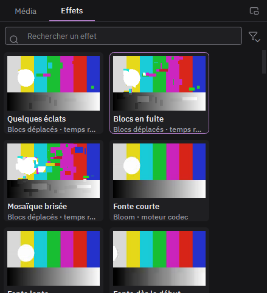

# Poser un effet

1. Ouvrez l'onglet **Effets**, à côté de Média, ou passez dans l'espace **Effets** (Maj+4).
2. Survolez une tuile pour voir l'effet en mouvement.
3. Glissez la tuile sur un clip. Ou sélectionnez le clip et double-cliquez la tuile.
4. Réglez l'effet dans l'**inspecteur**, à droite.

Glissée sur l'en-tête d'une piste, la tuile pose l'effet sur toute la piste. Glissée dans le vide d'une piste vidéo, elle crée un clip d'effet de 5 secondes qui agit sur tout ce qui est dessous.

Le bouton signet d'un effet l'enregistre comme préréglage personnel, dans Mes préréglages.
