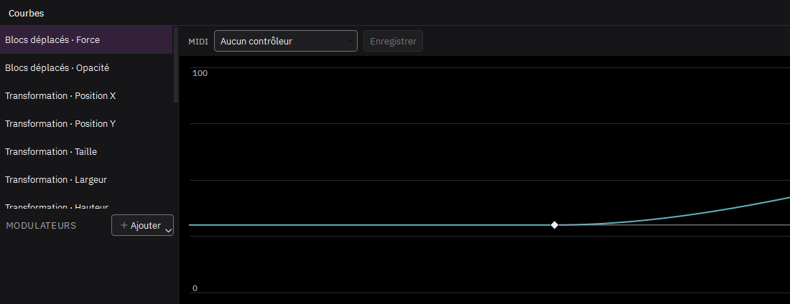
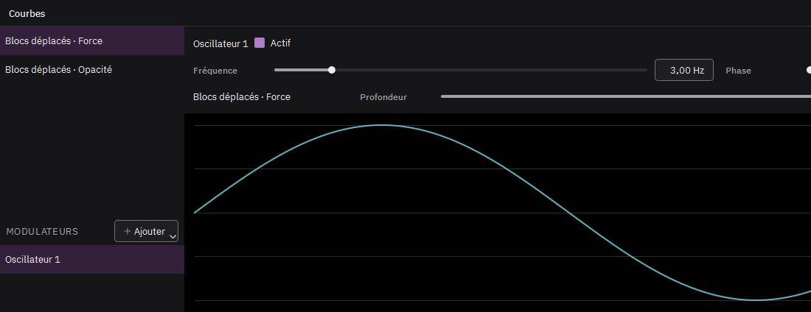

# Animer un effet

Un effet animé n'agit qu'entre sa première et sa dernière image clé. Avant et après, l'image d'origine reste intacte.

1. Placez la tête de lecture au début du passage.
2. Cliquez le losange devant un réglage : il se remplit, une image clé est posée.
3. Avancez la tête de lecture à la fin du passage.
4. Changez la valeur du réglage : une deuxième image clé se pose toute seule.

Sur le clip, les losanges et le trait qui les relie montrent où l'effet agit. Cliquez un losange pour y aller, glissez-le pour le déplacer dans le temps. Clic droit sur le losange de l'inspecteur : passage linéaire ou en palier, ou supprimer l'animation.

## Le panneau Courbes

Le bouton Courbes de la barre d'outils de la timeline ouvre le panneau, en onglet à côté de la timeline. À gauche, les réglages du clip choisi ; à droite, la courbe du réglage choisi.

- Double-clic sur le graphe : une image clé de plus.
- Glisser un losange : le déplacer dans le temps et en valeur.
- Clic droit sur un losange : le passage jusqu'à l'image clé suivante, linéaire, palier, lissé ou Bézier.
- En Bézier, tirez les poignées du losange choisi. Alt les détache l'une de l'autre.
- Suppr retire le losange choisi.

## Animer un masque

Devant chaque masque de l'inspecteur, le losange anime sa forme. Placez la tête de lecture, cliquez le losange, puis déplacez la tête et modifiez le masque sur l'image : une nouvelle image clé se pose. L'adoucissement et l'expansion s'animent de la même façon.

## Faire suivre un sujet par un masque

1. Placez la tête de lecture sur une image où le sujet est bien visible, et dessinez le masque autour de lui.
2. Cliquez la cible à droite du masque, dans l'inspecteur, puis Vers l'avant ou Vers l'arrière.
3. Le suivi se calcule en arrière-plan, jusqu'au bout du clip. Chaque position devient une image clé de la forme du masque.

Le suivi regarde l'image sans ses effets : un glitch ne le perd pas. Si le sujet sort de l'image ou se cache, le suivi s'arrête là et l'indique en bas de la fenêtre. Corrigez alors le masque à la main, puis relancez le suivi depuis cette image.

## Les modulateurs

Un modulateur fait varier un réglage tout seul, en plus de ses images clés : une oscillation, un hasard qui ondule, des pulsations au tempo.

1. Dans le panneau Courbes, clic droit sur un réglage, puis Moduler par et un nouveau modulateur : Oscillateur, Aléatoire lissé, Tempo ou Audio.
2. Choisissez le modulateur dans la liste du bas : ses réglages s'affichent au-dessus du graphe.
   - **Oscillateur** : forme (sinus, triangle, carré, dents de scie), fréquence, phase.
   - **Aléatoire lissé** : vitesse ; « Autre tirage » change le hasard.
   - **Tempo** : battements par minute, division, déclin de chaque impulsion, décalage.
   - **Audio** : le niveau du son d'une piste (ou de toutes), en volume ou dans les graves, les médiums ou les aigus ; sensibilité, attaque (vitesse de montée), relâche (vitesse de retombée).
3. La profondeur dit de combien le modulateur fait bouger le réglage, en % de sa plage. Négative, elle l'inverse.

Un même modulateur peut piloter plusieurs réglages : clic droit sur un autre réglage, Moduler par, puis son nom. Sur la courbe d'un réglage modulé, le pointillé montre les images clés et le trait plein le résultat.

Les modulateurs suivent le temps de la séquence. Le rendu est toujours le même : deux exports donnent les mêmes images.

## Enregistrer un contrôleur MIDI

Avec un contrôleur MIDI branché, choisissez un réglage dans le panneau Courbes : la barre MIDI s'affiche au-dessus du graphe.

1. Choisissez le contrôleur, puis cliquez Enregistrer.
2. Bougez le bouton ou le curseur voulu : c'est lui qui est retenu (son numéro s'affiche, par exemple CC 21).
3. Lancez la lecture et jouez : chaque mouvement pose une image clé à la tête de lecture.
4. Cliquez de nouveau Enregistrer pour arrêter.

Le geste devient une courbe ordinaire, à retoucher comme les autres : le rendu reste le même d'un export à l'autre.

Automator (Montage > Scripts) pose des images clés au hasard sur les réglages cochés d'un effet du clip choisi, à intervalle régulier. Elles se retouchent ensuite comme les autres.
