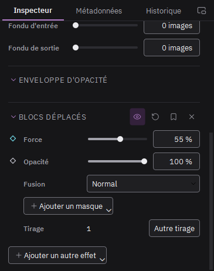
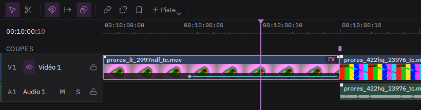

# Animer un effet

Un effet animé n'agit qu'entre sa première et sa dernière image clé. Avant et après, l'image d'origine reste intacte.

1. Placez la tête de lecture au début du passage.
2. Cliquez le losange devant un réglage : il se remplit, une image clé est posée.
3. Avancez la tête de lecture à la fin du passage.
4. Changez la valeur du réglage : une deuxième image clé se pose toute seule.

Sur le clip, les losanges et le trait qui les relie montrent où l'effet agit. Cliquez un losange pour y aller, glissez-le pour le déplacer dans le temps. Clic droit sur le losange de l'inspecteur : passage linéaire ou en palier, ou supprimer l'animation.
