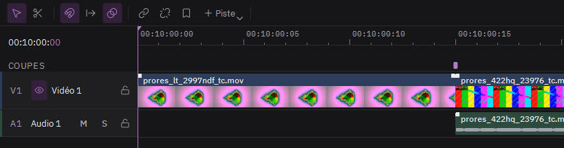

# Faire baver un plan dans le suivant

C'est la **transition datamosh** : l'image du premier plan reste et se déforme avec le mouvement du second.

1. Posez deux clips bout à bout sur la même piste vidéo, sans trou entre eux.
2. Dans la bande **Coupes**, au-dessus des pistes, cliquez le petit rectangle juste au-dessus du raccord. Il devient mauve.
3. Attendez que « Calcul… » disparaisse du clip, puis lisez le passage.

La zone hachurée au début du second clip montre la durée de la bavure. Tirez son bord droit pour l'allonger. Dans l'inspecteur, la section Transition datamosh règle aussi la taille des blocs.

Les autres rectangles de la bande Coupes marquent les changements de plan à l'intérieur d'une vidéo. Un clic fait baver le plan d'avant dans le suivant, au même endroit.
