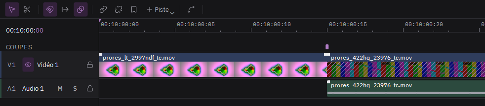

# Faire baver un plan dans le suivant

C'est la **transition datamosh** : l'image du premier plan reste et se déforme avec le mouvement du second.

1. Posez deux clips bout à bout sur la même piste vidéo, sans trou entre eux.
2. Dans la bande **Coupes**, au-dessus des pistes, cliquez le petit rectangle juste au-dessus du raccord. Il devient mauve.
3. Attendez que « Calcul… » disparaisse du clip, puis lisez le passage.

La zone hachurée au début du second clip montre la durée de la bavure. Tirez son bord droit pour l'allonger. Dans l'inspecteur, la section Transition datamosh règle aussi la taille des blocs et le **Fondu**, en images : sur la fin de la transition, la bavure s'efface peu à peu au lieu de laisser place à l'image nette d'un coup (0 : retour au net d'un coup). Sur la timeline, les hachures s'éclaircissent sur cette partie.

Les autres rectangles de la bande Coupes marquent les changements de plan à l'intérieur d'une vidéo. Un clic fait baver le plan d'avant dans le suivant, au même endroit.

## Façonner le glitch

Toujours dans la section Transition datamosh :

- **Préréglage** : Douce, Brutale (un coup violent au raccord, sans fondu), Explosion (les pixels gonflent puis éclatent), Cassée (blocs cassés et éclats). Changer un réglage la rend « Personnalisée ».
- **Intensité** : la force de la bavure. Au-delà de 100 %, l'image est arrachée plus fort ; en dessous de 0, elle part à rebours.
- **Évolution** : Constante, Coup d'abord (tout au raccord, puis de plus en plus calme) ou Montée.
- **Direction** : la bavure file sur les deux axes, ou seulement à l'horizontale ou à la verticale.
- **Bloom** : le mouvement du raccord se répète sur quelques images, l'image gonfle et traîne.
- **Corruption** : une part des données est abîmée pendant la bavure. Le tirage reste le même d'un export à l'autre.

Intensité, Évolution et Direction demandent FFglitch. Sur la timeline, une transition violente a des hachures croisées, et le nom de son préréglage s'y écrit.

La bavure part de l'image du premier plan telle qu'on la voit : ses effets passent dans le second plan.
