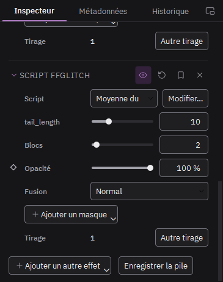

# Effets codec et scripts FFglitch

Les effets marqués « moteur codec » abîment la vidéo compressée elle-même : bavure, fonte des pixels, vecteurs de mouvement déformés. Ils se calculent en arrière-plan ; le badge « Calcul… » reste sur le clip le temps du calcul.

- **Vecteurs de mouvement** : amplifier, inverser (valeur négative), figer un axe (0 %), décaler, lisser, bruiter le mouvement.
- **Écho de mouvement, Zoom de mouvement, Saccades** : le mouvement répété, aspiré vers un centre, ou inversé par à-coups.
- **Transfert de mouvement** : le clip prend le mouvement du clip posé sur la piste juste au-dessus. Masquez cette piste avec l'œil, son mouvement sert quand même.
- **Script FFglitch** (famille Scripts) : un script de la bibliothèque. Les nombres déclarés en haut du script deviennent des réglages. « Modifier… » ouvre le script pour le changer.

Vos propres scripts, par exemple ceux de dd_GlitchAssist : Fichier > Importer des scripts FFglitch, puis choisissez leur dossier.
