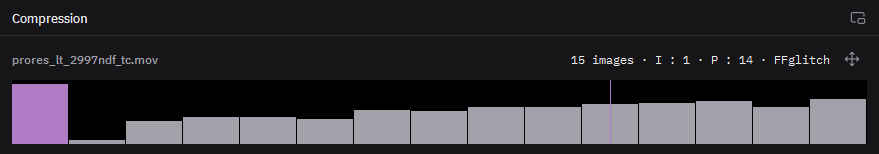

# Lire la compression d'un clip

Dans l'espace Effets, Fenêtre > Compression ouvre ce panneau sous le programme. Sélectionnez un clip vidéo : chaque barre est une image, haute comme son poids.

- **Barre mauve** : une image clé, image complète.
- **Barre grise** : une image qui ne contient que le mouvement depuis la précédente.
- **Contour mauve** : une image clé supprimée, là où le plan bave.

Cliquez une barre pour y aller. Double-cliquez une image clé pour la supprimer ou la rétablir. Le bouton à droite dessine sur le programme le mouvement que le datamosh va réutiliser.
