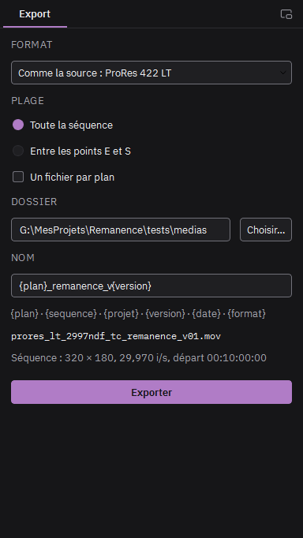

# Exporter

1. Passez dans l'espace **Export** (Maj+5 ou Ctrl+E).
2. Choisissez le format. ProRes 422 HQ garde la qualité pour la suite du montage.
3. Choisissez le dossier, puis le nom : un modèle où {plan} devient le nom du média, {version} le premier numéro libre (01, 02…), {date} la date du jour. Le nom obtenu s'affiche dessous.
4. Cliquez Exporter. L'export rejoint la file d'export, à droite, et se calcule en arrière-plan.

**Un fichier par plan** : chaque clip de la piste vidéo du bas devient un fichier, nommé d'après son média.

Les images sans effet sont recopiées telles quelles depuis la source. Après l'export, le rapport vérifie la durée, la cadence, la taille et le timecode.

## Échanger avec le monteur

- **Fichier > Importer un montage** : une EDL ou un FCP XML devient une séquence. Chaque plan est retrouvé parmi les médias importés par son nom et posé avec son timecode ; un plan sans média devient un marqueur.
- **Fichier > Exporter une liste de remplacement** : les plans exportés pendant la séance, en EDL ou FCP XML, à leur place dans le montage. Le monteur l'importe pour relier les nouveaux plans.
- **Fichier > Exporter l'image** (Ctrl+Maj+E) : l'image à la tête de lecture, en PNG 16 bits ou en EXR.
