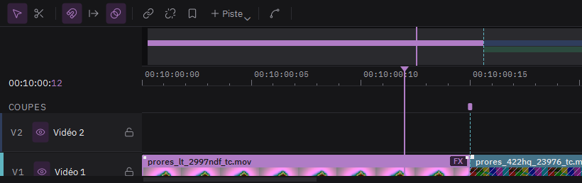

# Monter vite dans l'espace Cut

1. **Passer dans Cut** : Maj+2, ou Cut dans la barre du bas. Le moniteur a deux onglets, Source et Programme ; Q passe de l'un à l'autre.
2. **Bande source** : le bouton sous le moniteur enchaîne toutes les vidéos du panneau Média. Parcourez-la ; le plan sous la tête de lecture est celui qui sera posé. Sans point d'entrée ni de sortie, c'est le plan entier, d'un changement de plan au suivant.
3. **Poser** :
   - **Insérer** (Maj+F9) : au raccord le plus proche de la tête du programme, marqué en pointillés.
   - **À la fin** (Maj+F12) : au bout de la séquence.
   - **Remplacer** (Maj+F10) : à la place du plan sous la tête ; la suite se décale.
   - **Au-dessus** (F12) : sur une piste libre au-dessus, sans rien écraser.
4. **Se déplacer** : la bande du haut montre toute la séquence ; cliquez-y pour aller loin. La timeline du dessous garde la tête au centre.
5. **Ajuster un raccord** : Alt+gauche et Alt+droite déplacent d'une image le raccord marqué en pointillés (Alt+Maj : dix images).
6. **Revue rapide** : lit plus vite les longs plans, à vitesse normale les courts, pour parcourir un montage ou des heures de rushes.
7. **Découper aux changements de plan** (Ctrl+K, ou clic droit sur un clip) : un long enregistrement est coupé à chaque changement de plan.
