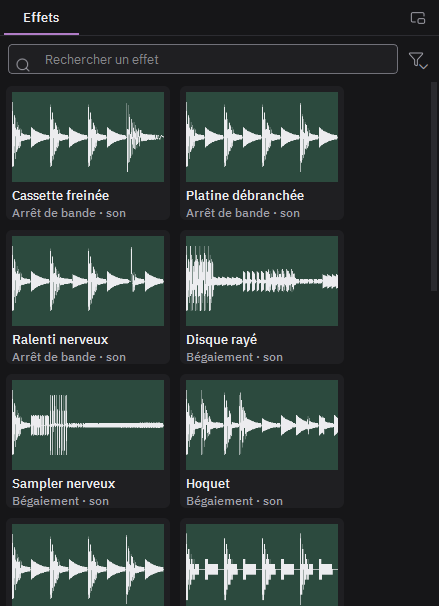

# Casser le son

1. **Poser un effet audio** : clic droit sur un clip audio (ou sur l'en-tête d'une piste audio), Ajouter un effet, Son. Dans la bibliothèque d'effets, le filtre Son montre les préréglages ; double-cliquez une tuile avec un clip vidéo choisi : l'effet va à son son.
2. **Régler** : dans l'inspecteur, les réglages de l'effet et son Mélange (0 % : le son d'origine). Les losanges posent des images clés, comme pour l'image ; un modulateur peut piloter un réglage.
3. **Les six effets** :
   - **Bégaiement** : un fragment rejoué, comme un disque rayé.
   - **Bitcrusher** : moins de bits et moins d'échantillons, son granuleux.
   - **Arrêt de bande** : le son ralentit et descend jusqu'à s'arrêter.
   - **Inversion par fragments** : des morceaux joués à l'envers.
   - **Gel** : un grain de son tenu.
   - **Databending audio** : le son passe par le format MP2, ses données sont abîmées.
4. **Le son bave avec l'image** : sur un clip qui a une transition datamosh (ou des images clés supprimées), cochez Le son bave dans l'inspecteur. Pendant que l'image du plan d'avant bave, son dernier grain de son tourne et s'efface.
5. **Autre tirage** donne un autre hasard ; le même tirage redonne toujours le même son, à la lecture comme à l'export.
