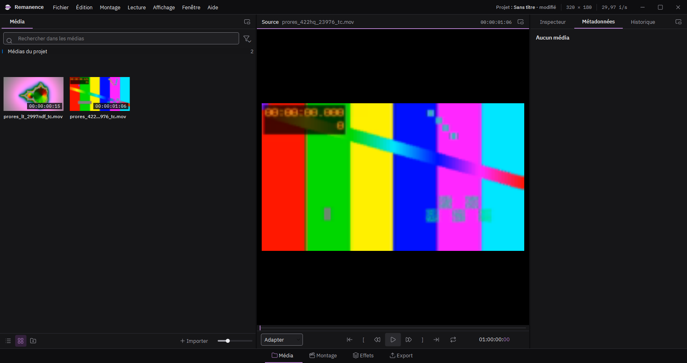
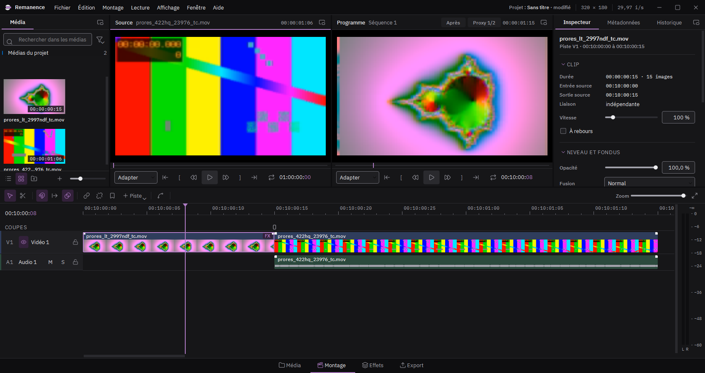
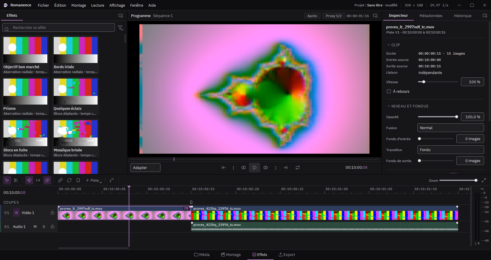
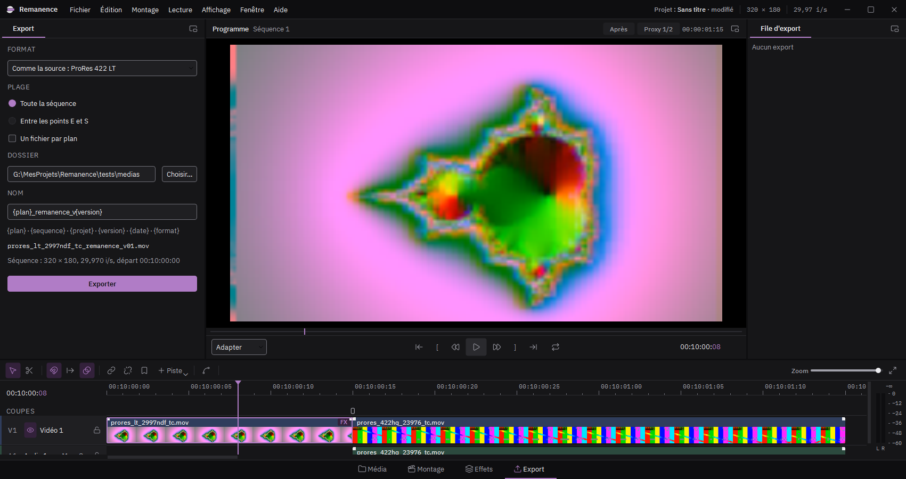

# L'écran

L'écran se partage en espaces de travail, choisis dans la barre du bas (ou Maj+1 à Maj+4). Chacun dispose les mêmes panneaux autrement, selon ce qu'on y fait.

## Média

Le panneau Média range les plans importés, en chutiers. Double-cliquez un plan pour le voir dans le moniteur Source. À droite, les métadonnées du plan choisi (format, codec, cadence, timecode).

## Montage

Deux moniteurs côte à côte : la source à gauche, le programme (la séquence montée) à droite. La timeline est dessous, l'inspecteur à droite : il montre les réglages de ce qui est choisi (clip, piste ou séquence).

## Effets

La bibliothèque d'effets prend la gauche : glissez une tuile sur un clip. Le programme est plus grand, et l'inspecteur montre les effets du clip choisi. Fenêtre > Compression ouvre l'analyse du codec d'un clip (images clés, poids des images, vecteurs de mouvement).

## Export

Les réglages d'export à gauche, la file des exports à droite.

## Double écran

Affichage > Double écran envoie des panneaux sur un second moniteur : Média, Métadonnées et Historique (comme dans DaVinci Resolve), ou toute la timeline. Ctrl+F montre le programme en plein écran.
